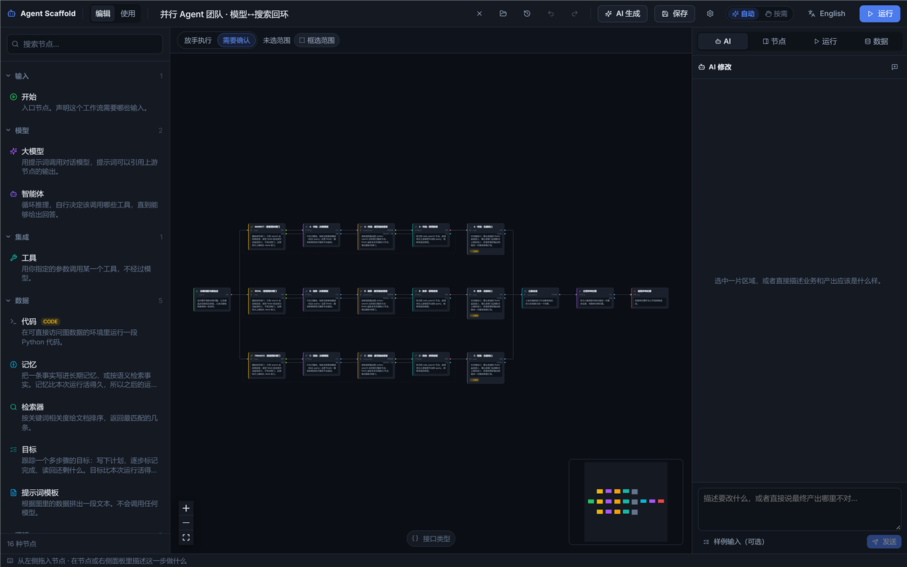
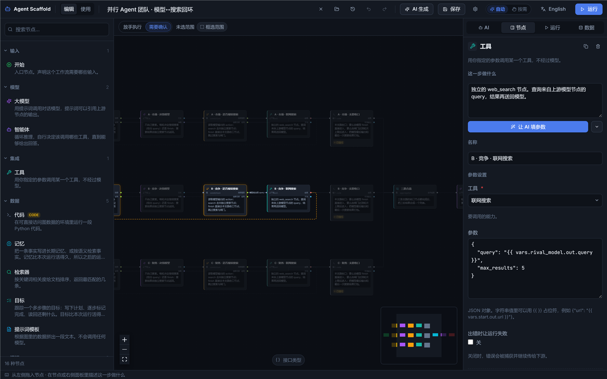
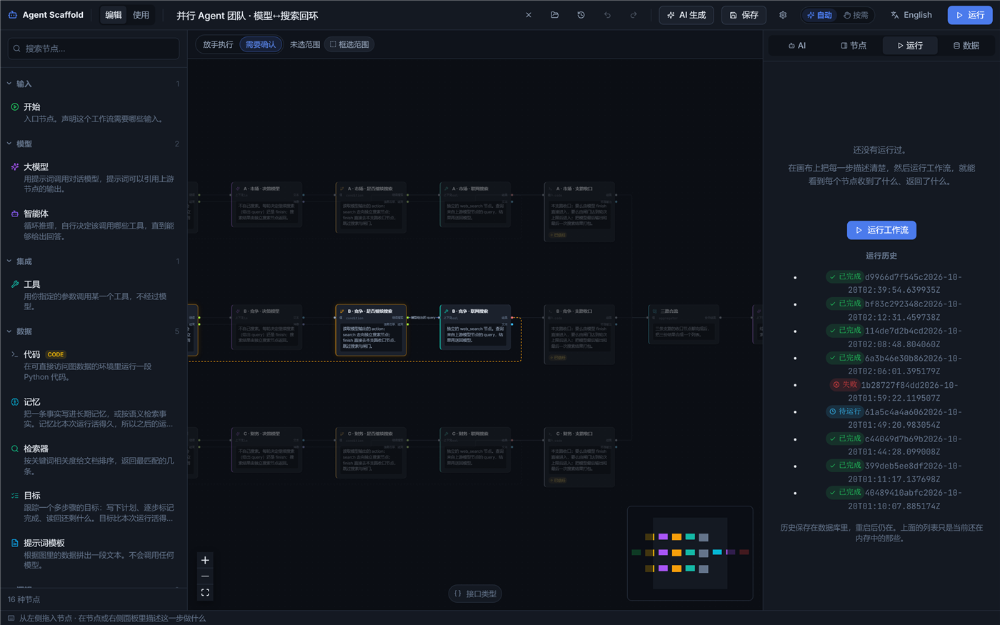
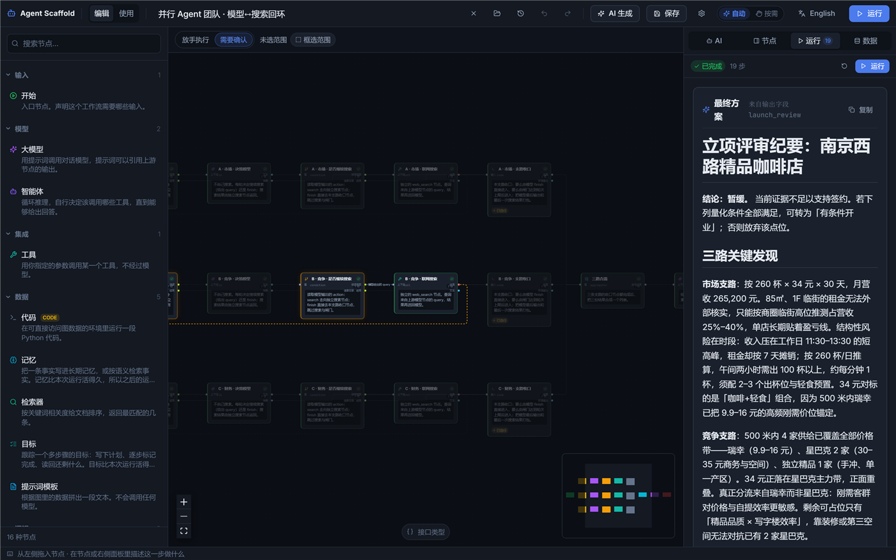
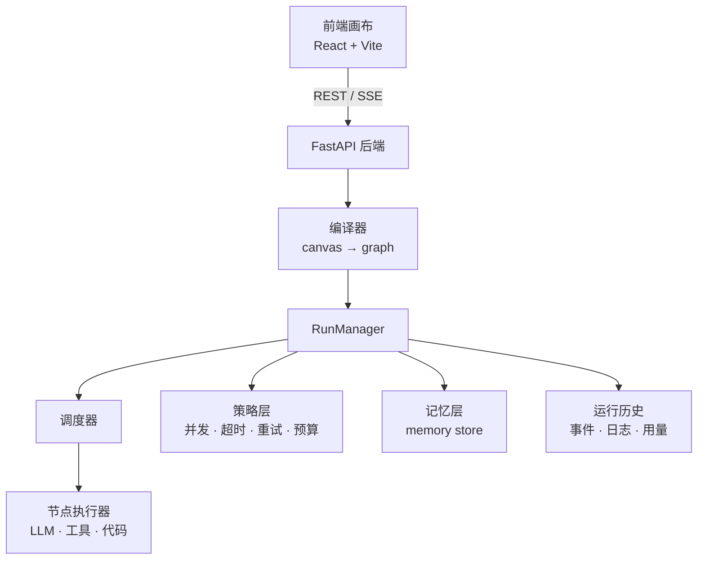

<p align="center">
  
</p>

<h1 align="center">Agent Scaffold</h1>

<p align="center">
  <b>在画布上搭 AI Agent 工作流，编译成可执行图。</b><br/>
  并发 · 预算 · 故障隔离 · 记忆 · 调度，各自独立成层。
</p>

<p align="center">
  <a href="https://github.com/hkhkkh/agent_scaffold/actions/workflows/ci.yml"></a>
  <a href="LICENSE"></a>
  <a href="https://github.com/hkhkkh/agent_scaffold/releases"></a>
  
  
  <a href="CONTRIBUTING.md"></a>
</p>

<p align="center"><i>A visual AI-agent workflow platform: design on a canvas, compile to an executable graph.
Concurrency, budget, fault isolation, memory and scheduling are independent layers.</i></p>

---

## ✨ 为什么做这个

大多数 Agent 框架把「编排、重试、预算、记忆、并发」揉在节点代码里，跑一次就再也复现不出来。
Agent Scaffold 把这些拆成独立的层：

- **画布即源码**：节点图是可编译的资产，一次编译、多次运行
- **可复现**：图哈希 + 版本锁定（runtime / 镜像 digest / 子图版本），同一张图跑出同样的结果
- **策略外置**：并发、超时、重试、预算都是执行器策略，不是业务代码
- **故障隔离**：单节点超时/失败/熔断不拖垮整张图
- **运行可观测**：每次 run 都有事件流、日志、用量与结果

## 📸 界面

| 画布编排 | 节点检查器 |
|---|---|
|  |  |

| 运行历史 | 结果与 Copilot |
|---|---|
|  |  |

| 内置 Copilot | 首页 |
|---|---|
|  |  |

## 🏗 架构



详细设计见 [docs/ARCHITECTURE.zh.md](docs/ARCHITECTURE.zh.md)。

## 🚀 快速开始

<details open>
<summary><b>后端（FastAPI）</b></summary>

```bash
cd backend
python -m venv .venv
# Windows: .venv\Scripts\activate   macOS/Linux: source .venv/bin/activate
pip install -r requirements.txt
cp .env.example .env      # 填 LLM_BASE_URL / LLM_API_KEY / LLM_MODEL
uvicorn app.main:app --reload --port 8000
```

不填 key 也能跑：默认 mock 模式，无网络调用、结果确定，方便先看流程。
</details>

<details open>
<summary><b>前端（React + Vite）</b></summary>

```bash
cd frontend
npm install
npm run dev        # http://localhost:5173
```
</details>

<details>
<summary><b>测试</b></summary>

```bash
cd backend && pytest -q
cd frontend && npm run test
```
</details>

## 🗂 目录结构

```
backend/    FastAPI 服务：app/（API、runtime、策略、记忆、安全）、tests/、migrations/
frontend/   React + TypeScript 画布、检查器、运行面板、Copilot
docs/       架构与设计文档、截图
scripts/    开发与冒烟脚本
```

## 🧭 路线图

- [x] 画布编排 → 编译执行
- [x] 运行历史 / 事件 / 用量
- [x] 预算、超时、重试、故障隔离
- [x] 内置 Copilot（生成 / 改图 / 解释）
- [ ] 更多节点类型与能力包
- [ ] 多租户与团队协作
- [ ] 可视化评测与回归

## 🤝 贡献

欢迎 issue 和 PR，规则见 [CONTRIBUTING.md](CONTRIBUTING.md)。
安全问题请按 [SECURITY.md](SECURITY.md) 私信报告，不要开公开 issue。
如果这个项目对你有用，点个 ⭐ 就是最大的支持。

## 📄 许可证

[MIT](LICENSE)
