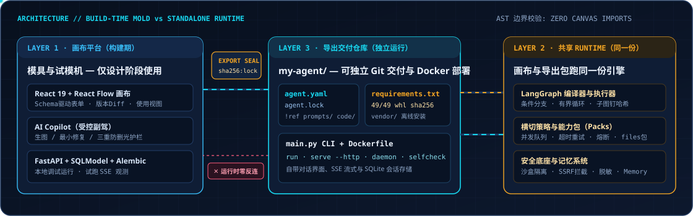
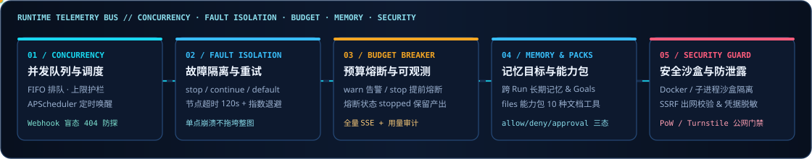
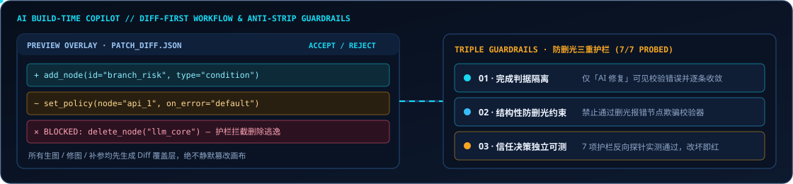
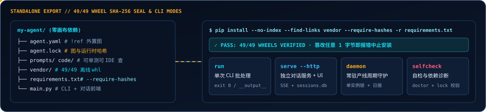
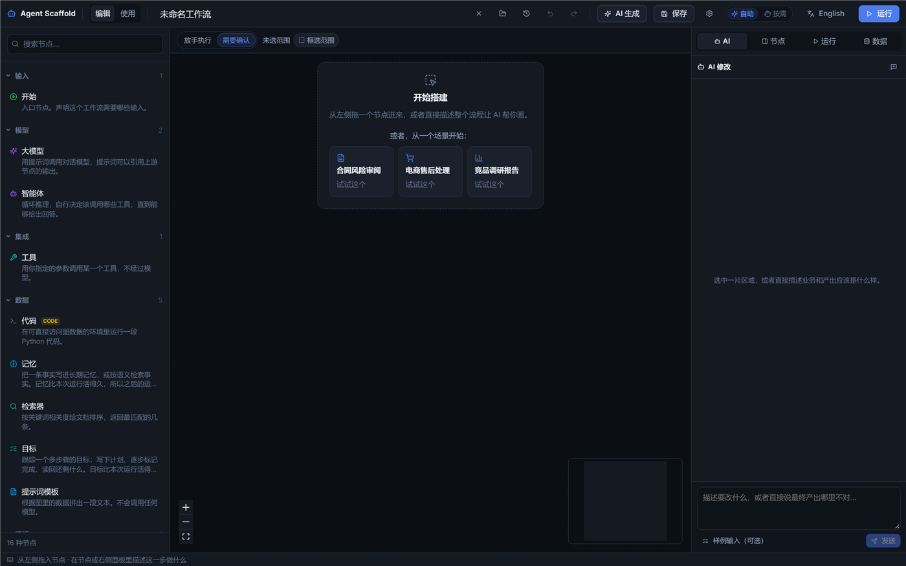
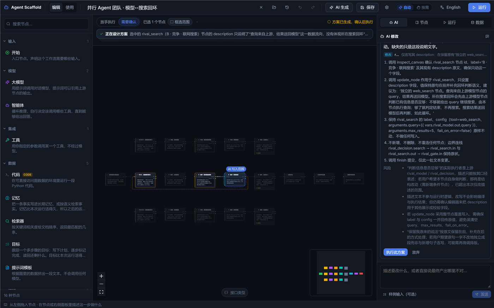

<p align="center">
  
</p>

<p align="center">
  <a href="https://hkhkkh.github.io/agent_scaffold/"></a>
  <a href="https://github.com/hkhkkh/agent_scaffold/actions/workflows/ci.yml"></a>
  <a href="https://github.com/hkhkkh/agent_scaffold/releases"></a>
  <a href="LICENSE"></a>
</p>

<p align="center">
  
  
  
  
  
  
  <a href="CONTRIBUTING.md"></a>
</p>

<p align="center">
  <b>在画布上设计 AI Agent 工作流，编译为 LangGraph 可执行图，并一键导出带 SHA-256 依赖封条的独立部署仓库。</b><br/>
  <i>Visual AI-Agent Workflow Studio · Canvas is the mold, LangGraph is the engine, exported repos run standalone.</i>
</p>

<p align="center">
  <a href="https://hkhkkh.github.io/agent_scaffold/"><b>交互式官网介绍页</b></a> ·
  <a href="#-为什么做-agent-scaffold"><b>架构理念</b></a> ·
  <a href="#-21-种注册表驱动节点"><b>节点体系</b></a> ·
  <a href="#-实机界面预览"><b>界面截图</b></a> ·
  <a href="#-快速开始"><b>快速开始</b></a> ·
  <a href="docs/ARCHITECTURE.zh.md"><b>完整架构文档</b></a>
</p>

<p align="center">
  
</p>

## ⚡ 为什么做 Agent Scaffold

大多数 Agent 框架把「编排、重试、预算、记忆、并发、鉴权」揉在业务节点代码里：换环境就跑不通，跑一次后难以复现；而低代码平台往往把 Agent 锁死在平台运行时里，无法独立交付给客户。

**Agent Scaffold 把“构建期画布”和“生产期运行时”彻底拆开：**

| 常见做法 | Agent Scaffold 的做法 |
|---|---|
| 业务与并发/重试/预算耦合在节点代码里 | **横切能力独立成层**：并发队列、节点超时、指数退避、预算熔断、记忆与安全全部外置 |
| Agent 依赖平台运行，无法脱离画布交付 | **导出即独立**：输出完整 Git 仓库结构与 `49/49` wheel SHA-256 封条，离开画布照样跑 |
| 每加一个节点都要改一遍前端表单 | **Schema 单一事实源**：后端 `ParamSpec` 驱动前端通用渲染，新增节点前端零改动 |
| AI 助手直接静默改图导致不可控 | **构建期 Copilot 走 Diff 预览**：必须人工 Accept/Reject，内置三重护栏防“删光通过校验” |

<p align="center">
  
</p>

> **AST 边界门禁强制证明**：`backend/tests/test_layer_boundary.py` 会用 AST 解析导出运行时源码，严禁出现任何 `app.db`、`app.api`、`fastapi` 或 `sqlmodel` 反向引用；画布试跑与导出生产运行的是**物理上同一份引擎**。

<p align="center">
  
</p>

## 🛸 运行时五层独立治理管线

<p align="center">
  
</p>

<details open>
<summary><b>展开查看六大核心引擎特性</b></summary>

1. **故障隔离与重试策略（`runtime/attempts.py`）**
   - 每个节点默认 120s 超时与可控重试次数，支持三态失败处理：`stop`（阻断并精确报错定位节点）、`continue`（记录错误继续跑）、`default`（向下游注入 `on_error_value` 兜底值）。
2. **Token / 步数预算熔断（`runtime/budget.py`）**
   - 软阈值触发步骤日志 `warn` 告警；触达硬上限平滑熔断为 `stopped` 状态，**完整保留已产出的阶段结果**。
3. **AI 构建期副驾与防删光护栏（`ai_buildtime/`）**
   - 自然语言生图、最小化错误修复、按描述补齐参数、`code` 节点与 Python 双向转换；所有改动以 Diff 预览浮层呈现，绝不静默覆盖画布。
4. **能力包底座与 `files` 工具包（`runtime/packs/`）**
   - 内置 `files` 能力包（10 个读写工具覆盖 CSV 中文/BOM/GB18030、多 Sheet Excel、PDF 与 DOCX），受 `allow` / `deny` / `approval`（无审批默认失败关闭）及 JSONL 写前审计约束。
5. **跨运行长期记忆、目标追踪与定时/Webhook 唤醒**
   - 基于 `langgraph.store` 实现跨多次 Run 的记忆读写与 `goal` 多阶段进度追踪；基于 APScheduler 的定时/守护调度，以及盲态 `404` 防探测与支持轮换的 `POST /api/hooks/<token>`。
6. **沙盒执行、SSRF 防护与凭据脱敏**
   - `code` 节点支持子进程与 Docker 沙盒；外网请求阻止内网/云元数据 IP；日志与序列化输出自动剥离密钥；公网演示模式提供 PoW + Cloudflare Turnstile 门禁。

</details>

<p align="center">
  
</p>

<p align="center">
  
</p>

## 🧩 21 种注册表驱动节点

所有节点均注册在 `backend/app/nodes/`，由后端 Pydantic `NodeTypeSpec` 统一声明中英文标题、端口类型矩阵与动态参数表单。

| 分类 | 节点类型（`type`） | 核心能力 |
|---|---|---|
| **输入与输出** | `start` · `end` | 声明输入 Schema 合并运行入参；收集结果并标记 `__output__` |
| **模型与智能体** | `llm` · `agent` | 逐 token SSE 流式推理、JSON 容错；可控 ReAct 循环与工具自纠 |
| **逻辑与控制** | `condition` · `loop` · `aggregator` · `supervisor` · `subgraph` | 动态分支出口；有界循环（Tarjan SCC 环路校验）；5 种汇聚策略；主管动态路由；钉哈希子图复用 |
| **数据与记忆** | `prompt` · `code` · `retriever` · `memory` · `goal` | 模板变量拼接；沙盒 Python；**BM25 关键词检索**；跨运行长期记忆与目标进度追踪 |
| **业务集成与人工** | `tool` · `human_input` · `api_call` · `fhir_query` · `sql_query` · `email_send` · `document_extract` | 确定性工具调用（含 `files` 能力包）；HITL `interrupt()` 审批；REST/OAuth2；FHIR 医疗；只读 SQL；邮件投递；沙盒文档解析 |

<p align="center">
  
</p>

## 📦 一键导出独立 Agent 仓库（`my-agent/`）

画布调试完成后，可导出为完全脱离画布平台的独立 Git 仓库，包含与画布相同底层代码的 `sha256` 封条：

<p align="center">
  
</p>

```text
my-agent/
├── agent.yaml          # 图定义与业务逻辑（提示词和代码通过 !ref 外置）
├── agent.lock          # 版本锁：graph_hash / runtime_digest / 子图哈希 / 封条标记
├── manifest.yml        # 启用能力包（如 packs: [files]）与会话存储声明
├── prompts/            # 独立管理的 Markdown 提示词文件
├── code/               # 独立导出的 Python 代码节点（可单测、可 IDE 检查）
├── tools/              # 客户业务接口适配与自定义工具
├── config/             # 模型、预算限流、能力开关与 .env.example（密钥绝不入包）
├── vendor/             # 49/49 离线 wheel 依赖包
├── requirements.txt    # 带 sha256 哈希封条（pip --require-hashes 篡改即报错）
├── Dockerfile          # 多阶段离线构建镜像
└── main.py             # 独立 CLI：run / serve --http（含对话 UI 与 SSE）/ daemon / selfcheck
```

<p align="center">
  
</p>

## 📸 实机界面预览

> 强烈建议点击进入 [**动态交互式介绍页 ↗**](https://hkhkkh.github.io/agent_scaffold/) 在线体验实时 DAG 执行沙盘、21 节点契约检索器与高清大图灯箱。

| 工作台首页与场景卡 | 可视化画布编排 |
|---|---|
|  |  |

| Schema 节点检查器 | 全链路运行历史 |
|---|---|
|  |  |

| 结构化产出与使用视图 | 受控 AI 副驾 Diff 预览 |
|---|---|
|  |  |

<p align="center">
  
</p>

## 🚀 快速开始

> **零配置即刻运行**：无需填写任何 LLM API Key 即可启动——默认开启确定性 **Mock 模式**，无外网请求即可体验完整编排、SSE 推流与导出流程。

<details open>
<summary><b>1. 启动后端（FastAPI · 端口 8001）</b></summary>

```bash
cd backend
python -m venv .venv
# Windows: .venv\Scripts\activate   |   macOS/Linux: source .venv/bin/activate
pip install -r requirements.txt

cp ../.env.example .env   # 可选：填写 LLM_BASE_URL / LLM_API_KEY / LLM_MODEL
uvicorn app.main:app --reload --port 8001
```
</details>

<details open>
<summary><b>2. 启动前端（React 19 + Vite · 端口 5173）</b></summary>

```bash
cd frontend
npm install
npm run dev               # 默认代理至 http://127.0.0.1:8001
```
</details>

<details>
<summary><b>3. 运行全量测试与 i18n 门禁</b></summary>

```bash
cd backend && pytest -q
cd backend && python scripts/check_i18n.py
cd frontend && npm run typecheck && npm run test
```
</details>

<p align="center">
  
</p>

## 🗂 仓库结构与文档索引

```text
agent_scaffold/
├── backend/
│   ├── app/
│   │   ├── api/            # HTTP 路由（workflows / runs / ai / schedules / hooks / access / files）
│   │   ├── graph/          # Schema（单一事实源）、26 条双语校验、LangGraph 编译器、子图与布局
│   │   ├── nodes/          # 21 种内置节点注册与执行器
│   │   ├── runtime/        # RunManager、超时容错、预算熔断、沙盒、能力包、导出与对话服务
│   │   ├── ai_buildtime/   # 构建期 Copilot（生图 / 修复 / 补参 / 护栏 / 自测）
│   │   ├── memory/         # 跨运行长期记忆与目标追踪
│   │   ├── scheduling/     # APScheduler 定时调度与事件触发
│   │   ├── security/       # 鉴权、限流、配额、脱敏、SSRF 与公网门禁
│   │   └── db/             # SQLModel 模型与 Alembic 迁移
│   └── tests/              # 55+ 测试模块（1,338+ 用例）
├── frontend/               # React 19 + TypeScript 画布、检查器、运行面板、Copilot 与使用视图
├── scripts/                # 开发启动、LLM 连通性检查、冒烟与部署脚本
└── docs/                   # 完整设计、现状、踩坑记录与 GitHub Pages 介绍站
```

- **必读入口**：[docs/00-start-here.md](docs/00-start-here.md) · [docs/ARCHITECTURE.zh.md](docs/ARCHITECTURE.zh.md) · [docs/user-guide.md](docs/user-guide.md)
- **实测现状与环境**：[docs/current/status.md](docs/current/status.md) · [docs/env/run.md](docs/env/run.md) · [docs/env/ports.md](docs/env/ports.md)
- **文档总目录**：[docs/README.md](docs/README.md)

## 🧭 路线图

- [x] 可视化画布编排 → 编译为 LangGraph 执行（21 种节点）
- [x] 运行历史、SSE 事件流、步骤日志与用量统计
- [x] 并发队列、节点超时重试、三态故障隔离与预算熔断
- [x] 内置 Copilot（生图 / 最小修复 / 补参 / Code 双向互转 / 三重防删光护栏）
- [x] 定义版本化、长期记忆、目标追踪与定时 / 盲态 Webhook 唤醒
- [x] 能力包底座（`files` 读写）与独立仓库导出（含对话 UI 与 49/49 SHA-256 封条）
- [ ] 更多垂直节点类型与外部能力包生态
- [ ] 多租户权限与团队协作编排
- [ ] 可视化评测集（Eval）与回归对比

## 🤝 贡献与安全

- 欢迎提交 Issue 与 Pull Request，规范见 [CONTRIBUTING.md](CONTRIBUTING.md)。
- 如发现安全问题，请按 [SECURITY.md](SECURITY.md) 指引私下报告，勿直接开公开 Issue。
- 如果这个项目对你有帮助，欢迎点亮右上角 ⭐ Star 支持！

## 📄 许可证

[MIT](LICENSE)
